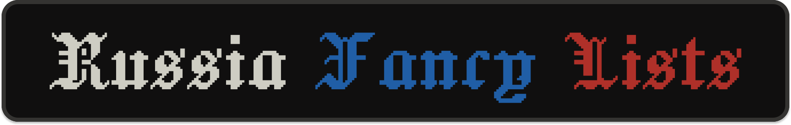

<div align="center">
  
  <p>This repository provides curated, auto-updating lists of domains and resources that are currently restricted or throttled in Russia. Perfect for your home-lab, VPN gateway, or custom routing setup.</p>
  <p>
    <picture><source media="(prefers-color-scheme: dark)" srcset="https://www.shieldcn.dev/github/stars/Noktomezo/RussiaFancyLists.svg?variant=secondary&size=xs&mode=dark&theme=neutral&font=geist-mono"></picture>
    <picture><source media="(prefers-color-scheme: dark)" srcset="https://www.shieldcn.dev/github/last-commit/Noktomezo/RussiaFancyLists.svg?variant=secondary&size=xs&mode=dark&theme=neutral&font=geist-mono"></picture>
    <picture><source media="(prefers-color-scheme: dark)" srcset="https://www.shieldcn.dev/github/commits/Noktomezo/RussiaFancyLists.svg?variant=secondary&size=xs&mode=dark&theme=neutral&font=geist-mono"></picture>
    <picture><source media="(prefers-color-scheme: dark)" srcset="https://www.shieldcn.dev/github/license/Noktomezo/RussiaFancyLists.svg?variant=ghost&size=xs&mode=dark&theme=neutral&font=geist-mono"></picture>
  </p>
  <p>🇬🇧 <b>English</b> • <a href="README.ru.md">🇷🇺 Русский</a></p>
</div>

## 👀 Content

> [!NOTE]
> 🤖 **Automated Updates**: Lists are updated every 3 hours (including 21:00 UTC / 00:00 GMT+3 — Moscow Standard Time) via GitHub Actions. Only pushes when lists actually change.

Generated artifacts are organized as follows:

<table width="100%">
  <thead>
    <tr>
      <th width="120" align="center"><b>Category</b></th>
      <th width="110" align="center"><b>Variant</b></th>
      <th width="100" align="center"><b>Type</b></th>
      <th width="450" align="center"><b>Files</b></th>
      <th width="220" align="center"><b>Size</b></th>
    </tr>
  </thead>
  <tbody>
    <tr>
      <td rowspan="6"><b>Blacklist</b></td>
      <td rowspan="2"><b>Text</b></td>
      <td><b>Domains</b></td>
      <td>
        • <a href="https://raw.githubusercontent.com/Noktomezo/RussiaFancyLists/main/lists/blacklist/domains/full.lst"><code>full.lst</code></a><br>
        • <a href="https://raw.githubusercontent.com/Noktomezo/RussiaFancyLists/main/lists/blacklist/domains/full-sld.lst"><code>full-sld.lst</code></a>
      </td>
      <td>
        • <!-- SIZE:lists/blacklist/domains/full.lst -->31.81 MB<!-- SIZE_END --><br>
        • <!-- SIZE:lists/blacklist/domains/full-sld.lst -->21.37 MB<!-- SIZE_END -->
      </td>
    </tr>
    <tr>
      <td><b>IP sets</b></td>
      <td>
        • <a href="https://raw.githubusercontent.com/Noktomezo/RussiaFancyLists/main/lists/blacklist/ipsets/full.lst"><code>full.lst</code></a><br>
        • <a href="https://raw.githubusercontent.com/Noktomezo/RussiaFancyLists/main/lists/blacklist/ipsets/full-and-cdn.lst"><code>full-and-cdn.lst</code></a><br>
        • <a href="https://raw.githubusercontent.com/Noktomezo/RussiaFancyLists/main/lists/blacklist/ipsets/cdn.lst"><code>cdn.lst</code></a>
      </td>
      <td>
        • <!-- SIZE:lists/blacklist/ipsets/full.lst -->949.6 KB<!-- SIZE_END --><br>
        • <!-- SIZE:lists/blacklist/ipsets/full-and-cdn.lst -->626.1 KB<!-- SIZE_END --><br>
        • <!-- SIZE:lists/blacklist/ipsets/cdn.lst -->186.4 KB<!-- SIZE_END -->
      </td>
    </tr>
    <tr>
      <td rowspan="2"><b>sing-box</b></td>
      <td><b>Domains</b></td>
      <td>
        • <a href="https://raw.githubusercontent.com/Noktomezo/RussiaFancyLists/main/lists/blacklist-sing-box/domains/full.json"><code>full.json</code></a><br>
        • <a href="https://raw.githubusercontent.com/Noktomezo/RussiaFancyLists/main/lists/blacklist-sing-box/domains/full.srs"><code>full.srs</code></a><br>
        • <a href="https://raw.githubusercontent.com/Noktomezo/RussiaFancyLists/main/lists/blacklist-sing-box/domains/full-sld.json"><code>full-sld.json</code></a><br>
        • <a href="https://raw.githubusercontent.com/Noktomezo/RussiaFancyLists/main/lists/blacklist-sing-box/domains/full-sld.srs"><code>full-sld.srs</code></a>
      </td>
      <td>
        • <!-- SIZE:lists/blacklist-sing-box/domains/full.json -->50.46 MB<!-- SIZE_END --><br>
        • <!-- SIZE:lists/blacklist-sing-box/domains/full.srs -->10.22 MB<!-- SIZE_END --><br>
        • <!-- SIZE:lists/blacklist-sing-box/domains/full-sld.json -->35.08 MB<!-- SIZE_END --><br>
        • <!-- SIZE:lists/blacklist-sing-box/domains/full-sld.srs -->7.34 MB<!-- SIZE_END -->
      </td>
    </tr>
    <tr>
      <td><b>IP sets</b></td>
      <td>
        • <a href="https://raw.githubusercontent.com/Noktomezo/RussiaFancyLists/main/lists/blacklist-sing-box/ipsets/full.json"><code>full.json</code></a><br>
        • <a href="https://raw.githubusercontent.com/Noktomezo/RussiaFancyLists/main/lists/blacklist-sing-box/ipsets/full.srs"><code>full.srs</code></a><br>
        • <a href="https://raw.githubusercontent.com/Noktomezo/RussiaFancyLists/main/lists/blacklist-sing-box/ipsets/full-and-cdn.json"><code>full-and-cdn.json</code></a><br>
        • <a href="https://raw.githubusercontent.com/Noktomezo/RussiaFancyLists/main/lists/blacklist-sing-box/ipsets/full-and-cdn.srs"><code>full-and-cdn.srs</code></a><br>
        • <a href="https://raw.githubusercontent.com/Noktomezo/RussiaFancyLists/main/lists/blacklist-sing-box/ipsets/cdn.json"><code>cdn.json</code></a><br>
        • <a href="https://raw.githubusercontent.com/Noktomezo/RussiaFancyLists/main/lists/blacklist-sing-box/ipsets/cdn.srs"><code>cdn.srs</code></a>
      </td>
      <td>
        • <!-- SIZE:lists/blacklist-sing-box/ipsets/full.json -->1.54 MB<!-- SIZE_END --><br>
        • <!-- SIZE:lists/blacklist-sing-box/ipsets/full.srs -->186.1 KB<!-- SIZE_END --><br>
        • <!-- SIZE:lists/blacklist-sing-box/ipsets/full-and-cdn.json -->1.02 MB<!-- SIZE_END --><br>
        • <!-- SIZE:lists/blacklist-sing-box/ipsets/full-and-cdn.srs -->142.6 KB<!-- SIZE_END --><br>
        • <!-- SIZE:lists/blacklist-sing-box/ipsets/cdn.json -->314.6 KB<!-- SIZE_END --><br>
        • <!-- SIZE:lists/blacklist-sing-box/ipsets/cdn.srs -->44.2 KB<!-- SIZE_END -->
      </td>
    </tr>
    <tr>
      <td rowspan="2"><b>Mihomo</b></td>
      <td><b>Domains</b></td>
      <td>
        • <a href="https://raw.githubusercontent.com/Noktomezo/RussiaFancyLists/main/lists/blacklist-mihomo/domains/full.yaml"><code>full.yaml</code></a><br>
        • <a href="https://raw.githubusercontent.com/Noktomezo/RussiaFancyLists/main/lists/blacklist-mihomo/domains/full.mrs"><code>full.mrs</code></a><br>
        • <a href="https://raw.githubusercontent.com/Noktomezo/RussiaFancyLists/main/lists/blacklist-mihomo/domains/full-sld.yaml"><code>full-sld.yaml</code></a><br>
        • <a href="https://raw.githubusercontent.com/Noktomezo/RussiaFancyLists/main/lists/blacklist-mihomo/domains/full-sld.mrs"><code>full-sld.mrs</code></a>
      </td>
      <td>
        • <!-- SIZE:lists/blacklist-mihomo/domains/full.yaml -->41.77 MB<!-- SIZE_END --><br>
        • <!-- SIZE:lists/blacklist-mihomo/domains/full.mrs -->9.68 MB<!-- SIZE_END --><br>
        • <!-- SIZE:lists/blacklist-mihomo/domains/full-sld.yaml -->28.85 MB<!-- SIZE_END --><br>
        • <!-- SIZE:lists/blacklist-mihomo/domains/full-sld.mrs -->6.75 MB<!-- SIZE_END -->
      </td>
    </tr>
    <tr>
      <td><b>IP sets</b></td>
      <td>
        • <a href="https://raw.githubusercontent.com/Noktomezo/RussiaFancyLists/main/lists/blacklist-mihomo/ipsets/full.yaml"><code>full.yaml</code></a><br>
        • <a href="https://raw.githubusercontent.com/Noktomezo/RussiaFancyLists/main/lists/blacklist-mihomo/ipsets/full.mrs"><code>full.mrs</code></a><br>
        • <a href="https://raw.githubusercontent.com/Noktomezo/RussiaFancyLists/main/lists/blacklist-mihomo/ipsets/full-and-cdn.yaml"><code>full-and-cdn.yaml</code></a><br>
        • <a href="https://raw.githubusercontent.com/Noktomezo/RussiaFancyLists/main/lists/blacklist-mihomo/ipsets/full-and-cdn.mrs"><code>full-and-cdn.mrs</code></a><br>
        • <a href="https://raw.githubusercontent.com/Noktomezo/RussiaFancyLists/main/lists/blacklist-mihomo/ipsets/cdn.yaml"><code>cdn.yaml</code></a><br>
        • <a href="https://raw.githubusercontent.com/Noktomezo/RussiaFancyLists/main/lists/blacklist-mihomo/ipsets/cdn.mrs"><code>cdn.mrs</code></a>
      </td>
      <td>
        • <!-- SIZE:lists/blacklist-mihomo/ipsets/full.yaml -->1.26 MB<!-- SIZE_END --><br>
        • <!-- SIZE:lists/blacklist-mihomo/ipsets/full.mrs -->217.6 KB<!-- SIZE_END --><br>
        • <!-- SIZE:lists/blacklist-mihomo/ipsets/full-and-cdn.yaml -->855.7 KB<!-- SIZE_END --><br>
        • <!-- SIZE:lists/blacklist-mihomo/ipsets/full-and-cdn.mrs -->180.9 KB<!-- SIZE_END --><br>
        • <!-- SIZE:lists/blacklist-mihomo/ipsets/cdn.yaml -->256.3 KB<!-- SIZE_END --><br>
        • <!-- SIZE:lists/blacklist-mihomo/ipsets/cdn.mrs -->58.6 KB<!-- SIZE_END -->
      </td>
    </tr>
    <tr>
      <td rowspan="3"><b>Geoblock</b></td>
      <td><b>Text</b></td>
      <td><b>Domains</b></td>
      <td>
        • <a href="https://raw.githubusercontent.com/Noktomezo/RussiaFancyLists/main/lists/geoblock/full.lst"><code>full.lst</code></a><br>
        • <a href="https://raw.githubusercontent.com/Noktomezo/RussiaFancyLists/main/lists/geoblock/full-sld.lst"><code>full-sld.lst</code></a>
      </td>
      <td>
        • <!-- SIZE:lists/geoblock/full.lst -->33.3 KB<!-- SIZE_END --><br>
        • <!-- SIZE:lists/geoblock/full-sld.lst -->13.8 KB<!-- SIZE_END -->
      </td>
    </tr>
    <tr>
      <td><b>sing-box</b></td>
      <td><b>Domains</b></td>
      <td>
        • <a href="https://raw.githubusercontent.com/Noktomezo/RussiaFancyLists/main/lists/geoblock-sing-box/full.json"><code>full.json</code></a><br>
        • <a href="https://raw.githubusercontent.com/Noktomezo/RussiaFancyLists/main/lists/geoblock-sing-box/full.srs"><code>full.srs</code></a><br>
        • <a href="https://raw.githubusercontent.com/Noktomezo/RussiaFancyLists/main/lists/geoblock-sing-box/full-sld.json"><code>full-sld.json</code></a><br>
        • <a href="https://raw.githubusercontent.com/Noktomezo/RussiaFancyLists/main/lists/geoblock-sing-box/full-sld.srs"><code>full-sld.srs</code></a>
      </td>
      <td>
        • <!-- SIZE:lists/geoblock-sing-box/full.json -->56.0 KB<!-- SIZE_END --><br>
        • <!-- SIZE:lists/geoblock-sing-box/full.srs -->13.7 KB<!-- SIZE_END --><br>
        • <!-- SIZE:lists/geoblock-sing-box/full-sld.json -->26.1 KB<!-- SIZE_END --><br>
        • <!-- SIZE:lists/geoblock-sing-box/full-sld.srs -->7.4 KB<!-- SIZE_END -->
      </td>
    </tr>
    <tr>
      <td><b>Mihomo</b></td>
      <td><b>Domains</b></td>
      <td>
        • <a href="https://raw.githubusercontent.com/Noktomezo/RussiaFancyLists/main/lists/geoblock-mihomo/full.yaml"><code>full.yaml</code></a><br>
        • <a href="https://raw.githubusercontent.com/Noktomezo/RussiaFancyLists/main/lists/geoblock-mihomo/full.mrs"><code>full.mrs</code></a><br>
        • <a href="https://raw.githubusercontent.com/Noktomezo/RussiaFancyLists/main/lists/geoblock-mihomo/full-sld.yaml"><code>full-sld.yaml</code></a><br>
        • <a href="https://raw.githubusercontent.com/Noktomezo/RussiaFancyLists/main/lists/geoblock-mihomo/full-sld.mrs"><code>full-sld.mrs</code></a>
      </td>
      <td>
        • <!-- SIZE:lists/geoblock-mihomo/full.yaml -->45.7 KB<!-- SIZE_END --><br>
        • <!-- SIZE:lists/geoblock-mihomo/full.mrs -->12.9 KB<!-- SIZE_END --><br>
        • <!-- SIZE:lists/geoblock-mihomo/full-sld.yaml -->20.5 KB<!-- SIZE_END --><br>
        • <!-- SIZE:lists/geoblock-mihomo/full-sld.mrs -->6.7 KB<!-- SIZE_END -->
      </td>
    </tr>
    <tr>
      <td rowspan="6"><b>Whitelist</b></td>
      <td rowspan="2"><b>Text</b></td>
      <td><b>Domains</b></td>
      <td>
        • <a href="https://raw.githubusercontent.com/Noktomezo/RussiaFancyLists/main/lists/whitelist/domains.lst"><code>domains.lst</code></a>
      </td>
      <td>
        • <!-- SIZE:lists/whitelist/domains.lst -->15.3 KB<!-- SIZE_END -->
      </td>
    </tr>
    <tr>
      <td><b>IP sets</b></td>
      <td>
        • <a href="https://raw.githubusercontent.com/Noktomezo/RussiaFancyLists/main/lists/whitelist/ipset.lst"><code>ipset.lst</code></a><br>
        • <a href="https://raw.githubusercontent.com/Noktomezo/RussiaFancyLists/main/lists/whitelist/cidr.lst"><code>cidr.lst</code></a>
      </td>
      <td>
        • <!-- SIZE:lists/whitelist/ipset.lst -->1.68 MB<!-- SIZE_END --><br>
        • <!-- SIZE:lists/whitelist/cidr.lst -->459.4 KB<!-- SIZE_END -->
      </td>
    </tr>
    <tr>
      <td rowspan="2"><b>sing-box</b></td>
      <td><b>Domains</b></td>
      <td>
        • <a href="https://raw.githubusercontent.com/Noktomezo/RussiaFancyLists/main/lists/whitelist-sing-box/domains.json"><code>domains.json</code></a><br>
        • <a href="https://raw.githubusercontent.com/Noktomezo/RussiaFancyLists/main/lists/whitelist-sing-box/domains.srs"><code>domains.srs</code></a>
      </td>
      <td>
        • <!-- SIZE:lists/whitelist-sing-box/domains.json -->25.2 KB<!-- SIZE_END --><br>
        • <!-- SIZE:lists/whitelist-sing-box/domains.srs -->3.8 KB<!-- SIZE_END -->
      </td>
    </tr>
    <tr>
      <td><b>IP sets</b></td>
      <td>
        • <a href="https://raw.githubusercontent.com/Noktomezo/RussiaFancyLists/main/lists/whitelist-sing-box/ipset.json"><code>ipset.json</code></a><br>
        • <a href="https://raw.githubusercontent.com/Noktomezo/RussiaFancyLists/main/lists/whitelist-sing-box/ipset.srs"><code>ipset.srs</code></a><br>
        • <a href="https://raw.githubusercontent.com/Noktomezo/RussiaFancyLists/main/lists/whitelist-sing-box/cidr.json"><code>cidr.json</code></a><br>
        • <a href="https://raw.githubusercontent.com/Noktomezo/RussiaFancyLists/main/lists/whitelist-sing-box/cidr.srs"><code>cidr.srs</code></a>
      </td>
      <td>
        • <!-- SIZE:lists/whitelist-sing-box/ipset.json -->3.16 MB<!-- SIZE_END --><br>
        • <!-- SIZE:lists/whitelist-sing-box/ipset.srs -->212.4 KB<!-- SIZE_END --><br>
        • <!-- SIZE:lists/whitelist-sing-box/cidr.json -->784.2 KB<!-- SIZE_END --><br>
        • <!-- SIZE:lists/whitelist-sing-box/cidr.srs -->73.0 KB<!-- SIZE_END -->
      </td>
    </tr>
    <tr>
      <td rowspan="2"><b>Mihomo</b></td>
      <td><b>Domains</b></td>
      <td>
        • <a href="https://raw.githubusercontent.com/Noktomezo/RussiaFancyLists/main/lists/whitelist-mihomo/domains.yaml"><code>domains.yaml</code></a><br>
        • <a href="https://raw.githubusercontent.com/Noktomezo/RussiaFancyLists/main/lists/whitelist-mihomo/domains.mrs"><code>domains.mrs</code></a>
      </td>
      <td>
        • <!-- SIZE:lists/whitelist-mihomo/domains.yaml -->20.6 KB<!-- SIZE_END --><br>
        • <!-- SIZE:lists/whitelist-mihomo/domains.mrs -->3.8 KB<!-- SIZE_END -->
      </td>
    </tr>
    <tr>
      <td><b>IP sets</b></td>
      <td>
        • <a href="https://raw.githubusercontent.com/Noktomezo/RussiaFancyLists/main/lists/whitelist-mihomo/ipset.yaml"><code>ipset.yaml</code></a><br>
        • <a href="https://raw.githubusercontent.com/Noktomezo/RussiaFancyLists/main/lists/whitelist-mihomo/ipset.mrs"><code>ipset.mrs</code></a><br>
        • <a href="https://raw.githubusercontent.com/Noktomezo/RussiaFancyLists/main/lists/whitelist-mihomo/cidr.yaml"><code>cidr.yaml</code></a><br>
        • <a href="https://raw.githubusercontent.com/Noktomezo/RussiaFancyLists/main/lists/whitelist-mihomo/cidr.mrs"><code>cidr.mrs</code></a>
      </td>
      <td>
        • <!-- SIZE:lists/whitelist-mihomo/ipset.yaml -->2.89 MB<!-- SIZE_END --><br>
        • <!-- SIZE:lists/whitelist-mihomo/ipset.mrs -->155.5 KB<!-- SIZE_END --><br>
        • <!-- SIZE:lists/whitelist-mihomo/cidr.yaml -->636.5 KB<!-- SIZE_END --><br>
        • <!-- SIZE:lists/whitelist-mihomo/cidr.mrs -->86.2 KB<!-- SIZE_END -->
      </td>
    </tr>
    <tr>
      <td rowspan="3"><b>Service</b></td>
      <td><b>Text</b></td>
      <td><b>Domains</b></td>
      <td>
        • <a href="https://raw.githubusercontent.com/Noktomezo/RussiaFancyLists/main/lists/service/prefer-direct.lst"><code>prefer-direct.lst</code></a><br>
        • <a href="https://raw.githubusercontent.com/Noktomezo/RussiaFancyLists/main/lists/service/direct-with-ech.lst"><code>direct-with-ech.lst</code></a>
      </td>
      <td>
        • <!-- SIZE:lists/service/prefer-direct.lst -->8.3 KB<!-- SIZE_END --><br>
        • <!-- SIZE:lists/service/direct-with-ech.lst -->239.4 KB<!-- SIZE_END -->
      </td>
    </tr>
    <tr>
      <td><b>sing-box</b></td>
      <td><b>Domains</b></td>
      <td>
        • <a href="https://raw.githubusercontent.com/Noktomezo/RussiaFancyLists/main/lists/service-sing-box/prefer-direct.json"><code>prefer-direct.json</code></a><br>
        • <a href="https://raw.githubusercontent.com/Noktomezo/RussiaFancyLists/main/lists/service-sing-box/prefer-direct.srs"><code>prefer-direct.srs</code></a><br>
        • <a href="https://raw.githubusercontent.com/Noktomezo/RussiaFancyLists/main/lists/service-sing-box/direct-with-ech.json"><code>direct-with-ech.json</code></a><br>
        • <a href="https://raw.githubusercontent.com/Noktomezo/RussiaFancyLists/main/lists/service-sing-box/direct-with-ech.srs"><code>direct-with-ech.srs</code></a>
      </td>
      <td>
        • <!-- SIZE:lists/service-sing-box/prefer-direct.json -->14.9 KB<!-- SIZE_END --><br>
        • <!-- SIZE:lists/service-sing-box/prefer-direct.srs -->4.5 KB<!-- SIZE_END --><br>
        • <!-- SIZE:lists/service-sing-box/direct-with-ech.json -->409.4 KB<!-- SIZE_END --><br>
        • <!-- SIZE:lists/service-sing-box/direct-with-ech.srs -->103.9 KB<!-- SIZE_END -->
      </td>
    </tr>
    <tr>
      <td><b>Mihomo</b></td>
      <td><b>Domains</b></td>
      <td>
        • <a href="https://raw.githubusercontent.com/Noktomezo/RussiaFancyLists/main/lists/service-mihomo/prefer-direct.yaml"><code>prefer-direct.yaml</code></a><br>
        • <a href="https://raw.githubusercontent.com/Noktomezo/RussiaFancyLists/main/lists/service-mihomo/prefer-direct.mrs"><code>prefer-direct.mrs</code></a><br>
        • <a href="https://raw.githubusercontent.com/Noktomezo/RussiaFancyLists/main/lists/service-mihomo/direct-with-ech.yaml"><code>direct-with-ech.yaml</code></a><br>
        • <a href="https://raw.githubusercontent.com/Noktomezo/RussiaFancyLists/main/lists/service-mihomo/direct-with-ech.mrs"><code>direct-with-ech.mrs</code></a>
      </td>
      <td>
        • <!-- SIZE:lists/service-mihomo/prefer-direct.yaml -->11.9 KB<!-- SIZE_END --><br>
        • <!-- SIZE:lists/service-mihomo/prefer-direct.mrs -->4.1 KB<!-- SIZE_END --><br>
        • <!-- SIZE:lists/service-mihomo/direct-with-ech.yaml -->332.1 KB<!-- SIZE_END --><br>
        • <!-- SIZE:lists/service-mihomo/direct-with-ech.mrs -->103.3 KB<!-- SIZE_END -->
      </td>
    </tr>
  </tbody>
</table>

> [!TIP]
> **💡 Detailed Description of Categories & Lists:**
> Full details on each list category and specialized routing list (including `prefer-direct` and `direct-with-ech`) can be found in our [Knowledge Base: List Categories](https://github.com/Noktomezo/RussiaFancyLists/wiki/List-Categories).

## 🌐 Free & Reliable Geoblock Bypass

> [!TIP]
> **🚀 Quick Start via DoH (DNS over HTTPS):**
> If you don't want to download `hosts` files or configure AdGuard Home, you can simply use this ready-made secure DNS endpoint:
> ```text
> https://ys39tfku2v.cloudflare-gateway.com/dns-query
> ```
> Add this address to "Secure DNS" in your browser, router, or proxy client (sing-box, Mihomo, Clash, AdGuard). Restricted and geoblocked websites will open automatically, while all other traffic resolves at full speed directly through Cloudflare DNS.
>
> 📖 For full setup guides (including OpenWrt, Zapret integration, and resolving IPv6/browser leaks), see [Knowledge Base: DNS Setup](https://github.com/Noktomezo/RussiaFancyLists/wiki/DNS-Setup) and [Troubleshooting](https://github.com/Noktomezo/RussiaFancyLists/wiki/Troubleshooting).

Direct hosts file mappings and Smart DNS rules for bypassing geoblocks and local censorship:

<!-- HOSTS_TABLE_START -->
<table width="100%">
  <thead>
    <tr>
      <th width="120" align="center"><b>Variant</b></th>
      <th width="180" align="center"><b>Target</b></th>
      <th width="370" align="center"><b>Files</b></th>
      <th width="150" align="center"><b>Size</b></th>
      <th width="180" align="center"><b>Geoblock Coverage</b></th>
    </tr>
  </thead>
  <tbody>
    <tr>
      <td rowspan="13"><b>Hosts</b></td>
      <td><b>Smart</b>&nbsp;❤️</td>
      <td>
        • <a href="https://raw.githubusercontent.com/Noktomezo/RussiaFancyLists/main/lists/hosts/smart.hosts"><code>smart.hosts</code></a><br>
        • <a href="https://raw.githubusercontent.com/Noktomezo/RussiaFancyLists/main/lists/hosts/smart-no-crutch.hosts"><code>smart-no-crutch.hosts</code></a>
      </td>
      <td>
        • <!-- SIZE:lists/hosts/smart.hosts -->58.3 KB<!-- SIZE_END --><br>
        • <!-- SIZE:lists/hosts/smart-no-crutch.hosts -->55.9 KB<!-- SIZE_END -->
      </td>
      <td>
        • 1195/2102<br>
        • 1195/2102
      </td>
    </tr>
    <tr>
      <td><b>Combined</b>&nbsp;⚠️</td>
      <td>
        • <a href="https://raw.githubusercontent.com/Noktomezo/RussiaFancyLists/main/lists/hosts/combined.hosts"><code>combined.hosts</code></a><br>
        • <a href="https://raw.githubusercontent.com/Noktomezo/RussiaFancyLists/main/lists/hosts/combined-no-crutch.hosts"><code>combined-no-crutch.hosts</code></a>
      </td>
      <td>
        • <!-- SIZE:lists/hosts/combined.hosts -->58.6 KB<!-- SIZE_END --><br>
        • <!-- SIZE:lists/hosts/combined-no-crutch.hosts -->56.2 KB<!-- SIZE_END -->
      </td>
      <td>
        • 2102/2102<br>
        • 2102/2102
      </td>
    </tr>
    <tr>
      <td><b>GeoHide</b></td>
      <td>
        • <a href="https://raw.githubusercontent.com/Noktomezo/RussiaFancyLists/main/lists/hosts/geohide.hosts"><code>geohide.hosts</code></a><br>
        • <a href="https://raw.githubusercontent.com/Noktomezo/RussiaFancyLists/main/lists/hosts/geohide-no-crutch.hosts"><code>geohide-no-crutch.hosts</code></a>
      </td>
      <td>
        • <!-- SIZE:lists/hosts/geohide.hosts -->53.7 KB<!-- SIZE_END --><br>
        • <!-- SIZE:lists/hosts/geohide-no-crutch.hosts -->51.3 KB<!-- SIZE_END -->
      </td>
      <td>
        • 1075/2102<br>
        • 1075/2102
      </td>
    </tr>
    <tr>
      <td><b>Comss</b></td>
      <td>
        • <a href="https://raw.githubusercontent.com/Noktomezo/RussiaFancyLists/main/lists/hosts/comss.hosts"><code>comss.hosts</code></a><br>
        • <a href="https://raw.githubusercontent.com/Noktomezo/RussiaFancyLists/main/lists/hosts/comss-no-crutch.hosts"><code>comss-no-crutch.hosts</code></a>
      </td>
      <td>
        • <!-- SIZE:lists/hosts/comss.hosts -->15.7 KB<!-- SIZE_END --><br>
        • <!-- SIZE:lists/hosts/comss-no-crutch.hosts -->13.3 KB<!-- SIZE_END -->
      </td>
      <td>
        • 293/2102<br>
        • 293/2102
      </td>
    </tr>
    <tr>
      <td><b>Xbox DNS</b></td>
      <td>
        • <a href="https://raw.githubusercontent.com/Noktomezo/RussiaFancyLists/main/lists/hosts/xbox-dns.hosts"><code>xbox-dns.hosts</code></a><br>
        • <a href="https://raw.githubusercontent.com/Noktomezo/RussiaFancyLists/main/lists/hosts/xbox-dns-no-crutch.hosts"><code>xbox-dns-no-crutch.hosts</code></a>
      </td>
      <td>
        • <!-- SIZE:lists/hosts/xbox-dns.hosts -->2.6 KB<!-- SIZE_END --><br>
        • <!-- SIZE:lists/hosts/xbox-dns-no-crutch.hosts -->219 B<!-- SIZE_END -->
      </td>
      <td>
        • 3/2102<br>
        • 3/2102
      </td>
    </tr>
    <tr>
      <td><b>dns-ai</b></td>
      <td colspan="3" align="center">🚫 Unavailable</td>
    </tr>
    <tr>
      <td><b>AstraCat</b></td>
      <td>
        • <a href="https://raw.githubusercontent.com/Noktomezo/RussiaFancyLists/main/lists/hosts/astracat.hosts"><code>astracat.hosts</code></a><br>
        • <a href="https://raw.githubusercontent.com/Noktomezo/RussiaFancyLists/main/lists/hosts/astracat-no-crutch.hosts"><code>astracat-no-crutch.hosts</code></a>
      </td>
      <td>
        • <!-- SIZE:lists/hosts/astracat.hosts -->6.6 KB<!-- SIZE_END --><br>
        • <!-- SIZE:lists/hosts/astracat-no-crutch.hosts -->4.2 KB<!-- SIZE_END -->
      </td>
      <td>
        • 169/2102<br>
        • 169/2102
      </td>
    </tr>
    <tr>
      <td><b>XyZ</b></td>
      <td colspan="3" align="center">🚫 Unavailable</td>
    </tr>
    <tr>
      <td><b>ImMALWARE</b></td>
      <td>
        • <a href="https://raw.githubusercontent.com/Noktomezo/RussiaFancyLists/main/lists/hosts/malw.hosts"><code>malw.hosts</code></a><br>
        • <a href="https://raw.githubusercontent.com/Noktomezo/RussiaFancyLists/main/lists/hosts/malw-no-crutch.hosts"><code>malw-no-crutch.hosts</code></a>
      </td>
      <td>
        • <!-- SIZE:lists/hosts/malw.hosts -->11.0 KB<!-- SIZE_END --><br>
        • <!-- SIZE:lists/hosts/malw-no-crutch.hosts -->8.6 KB<!-- SIZE_END -->
      </td>
      <td>
        • 276/2102<br>
        • 276/2102
      </td>
    </tr>
    <tr>
      <td><b>Mafioznik</b></td>
      <td colspan="3" align="center">🚫 Unavailable</td>
    </tr>
    <tr>
      <td><b>Bezmezhau</b></td>
      <td>
        • <a href="https://raw.githubusercontent.com/Noktomezo/RussiaFancyLists/main/lists/hosts/bezmezhau.hosts"><code>bezmezhau.hosts</code></a><br>
        • <a href="https://raw.githubusercontent.com/Noktomezo/RussiaFancyLists/main/lists/hosts/bezmezhau-no-crutch.hosts"><code>bezmezhau-no-crutch.hosts</code></a>
      </td>
      <td>
        • <!-- SIZE:lists/hosts/bezmezhau.hosts -->20.3 KB<!-- SIZE_END --><br>
        • <!-- SIZE:lists/hosts/bezmezhau-no-crutch.hosts -->17.9 KB<!-- SIZE_END -->
      </td>
      <td>
        • 856/2102<br>
        • 856/2102
      </td>
    </tr>
    <tr>
      <td><b>WL DNS</b></td>
      <td>
        • <a href="https://raw.githubusercontent.com/Noktomezo/RussiaFancyLists/main/lists/hosts/wl-dns.hosts"><code>wl-dns.hosts</code></a><br>
        • <a href="https://raw.githubusercontent.com/Noktomezo/RussiaFancyLists/main/lists/hosts/wl-dns-no-crutch.hosts"><code>wl-dns-no-crutch.hosts</code></a>
      </td>
      <td>
        • <!-- SIZE:lists/hosts/wl-dns.hosts -->7.5 KB<!-- SIZE_END --><br>
        • <!-- SIZE:lists/hosts/wl-dns-no-crutch.hosts -->5.1 KB<!-- SIZE_END -->
      </td>
      <td>
        • 221/2102<br>
        • 221/2102
      </td>
    </tr>
    <tr>
      <td><b>Only Crutch</b></td>
      <td>
        • <a href="https://raw.githubusercontent.com/Noktomezo/RussiaFancyLists/main/lists/hosts/only-crutch.hosts"><code>only-crutch.hosts</code></a>
      </td>
      <td>
        • <!-- SIZE:lists/hosts/only-crutch.hosts -->2.5 KB<!-- SIZE_END -->
      </td>
      <td>
        • —
      </td>
    </tr>
    <tr>
      <td rowspan="13"><b>AdGuard Home</b></td>
      <td><b>Smart</b>&nbsp;❤️</td>
      <td>
        • <a href="https://raw.githubusercontent.com/Noktomezo/RussiaFancyLists/main/lists/hosts/smart.adguard.txt"><code>smart.adguard.txt</code></a><br>
        • <a href="https://raw.githubusercontent.com/Noktomezo/RussiaFancyLists/main/lists/hosts/smart-no-crutch.adguard.txt"><code>smart-no-crutch.adguard.txt</code></a>
      </td>
      <td>
        • <!-- SIZE:lists/hosts/smart.adguard.txt -->132.9 KB<!-- SIZE_END --><br>
        • <!-- SIZE:lists/hosts/smart-no-crutch.adguard.txt -->127.3 KB<!-- SIZE_END -->
      </td>
      <td>
        • 1195/2102<br>
        • 1195/2102
      </td>
    </tr>
    <tr>
      <td><b>Combined</b>&nbsp;⚠️</td>
      <td>
        • <a href="https://raw.githubusercontent.com/Noktomezo/RussiaFancyLists/main/lists/hosts/combined.adguard.txt"><code>combined.adguard.txt</code></a><br>
        • <a href="https://raw.githubusercontent.com/Noktomezo/RussiaFancyLists/main/lists/hosts/combined-no-crutch.adguard.txt"><code>combined-no-crutch.adguard.txt</code></a>
      </td>
      <td>
        • <!-- SIZE:lists/hosts/combined.adguard.txt -->117.2 KB<!-- SIZE_END --><br>
        • <!-- SIZE:lists/hosts/combined-no-crutch.adguard.txt -->111.7 KB<!-- SIZE_END -->
      </td>
      <td>
        • 2102/2102<br>
        • 2102/2102
      </td>
    </tr>
    <tr>
      <td><b>GeoHide</b></td>
      <td>
        • <a href="https://raw.githubusercontent.com/Noktomezo/RussiaFancyLists/main/lists/hosts/geohide.adguard.txt"><code>geohide.adguard.txt</code></a><br>
        • <a href="https://raw.githubusercontent.com/Noktomezo/RussiaFancyLists/main/lists/hosts/geohide-no-crutch.adguard.txt"><code>geohide-no-crutch.adguard.txt</code></a>
      </td>
      <td>
        • <!-- SIZE:lists/hosts/geohide.adguard.txt -->122.9 KB<!-- SIZE_END --><br>
        • <!-- SIZE:lists/hosts/geohide-no-crutch.adguard.txt -->117.4 KB<!-- SIZE_END -->
      </td>
      <td>
        • 1075/2102<br>
        • 1075/2102
      </td>
    </tr>
    <tr>
      <td><b>Comss</b></td>
      <td>
        • <a href="https://raw.githubusercontent.com/Noktomezo/RussiaFancyLists/main/lists/hosts/comss.adguard.txt"><code>comss.adguard.txt</code></a><br>
        • <a href="https://raw.githubusercontent.com/Noktomezo/RussiaFancyLists/main/lists/hosts/comss-no-crutch.adguard.txt"><code>comss-no-crutch.adguard.txt</code></a>
      </td>
      <td>
        • <!-- SIZE:lists/hosts/comss.adguard.txt -->37.5 KB<!-- SIZE_END --><br>
        • <!-- SIZE:lists/hosts/comss-no-crutch.adguard.txt -->32.0 KB<!-- SIZE_END -->
      </td>
      <td>
        • 293/2102<br>
        • 293/2102
      </td>
    </tr>
    <tr>
      <td><b>Xbox DNS</b></td>
      <td>
        • <a href="https://raw.githubusercontent.com/Noktomezo/RussiaFancyLists/main/lists/hosts/xbox-dns.adguard.txt"><code>xbox-dns.adguard.txt</code></a><br>
        • <a href="https://raw.githubusercontent.com/Noktomezo/RussiaFancyLists/main/lists/hosts/xbox-dns-no-crutch.adguard.txt"><code>xbox-dns-no-crutch.adguard.txt</code></a>
      </td>
      <td>
        • <!-- SIZE:lists/hosts/xbox-dns.adguard.txt -->5.9 KB<!-- SIZE_END --><br>
        • <!-- SIZE:lists/hosts/xbox-dns-no-crutch.adguard.txt -->323 B<!-- SIZE_END -->
      </td>
      <td>
        • 3/2102<br>
        • 3/2102
      </td>
    </tr>
    <tr>
      <td><b>dns-ai</b></td>
      <td colspan="3" align="center">🚫 Unavailable</td>
    </tr>
    <tr>
      <td><b>AstraCat</b></td>
      <td>
        • <a href="https://raw.githubusercontent.com/Noktomezo/RussiaFancyLists/main/lists/hosts/astracat.adguard.txt"><code>astracat.adguard.txt</code></a><br>
        • <a href="https://raw.githubusercontent.com/Noktomezo/RussiaFancyLists/main/lists/hosts/astracat-no-crutch.adguard.txt"><code>astracat-no-crutch.adguard.txt</code></a>
      </td>
      <td>
        • <!-- SIZE:lists/hosts/astracat.adguard.txt -->15.1 KB<!-- SIZE_END --><br>
        • <!-- SIZE:lists/hosts/astracat-no-crutch.adguard.txt -->9.5 KB<!-- SIZE_END -->
      </td>
      <td>
        • 169/2102<br>
        • 169/2102
      </td>
    </tr>
    <tr>
      <td><b>XyZ</b></td>
      <td colspan="3" align="center">🚫 Unavailable</td>
    </tr>
    <tr>
      <td><b>ImMALWARE</b></td>
      <td>
        • <a href="https://raw.githubusercontent.com/Noktomezo/RussiaFancyLists/main/lists/hosts/malw.adguard.txt"><code>malw.adguard.txt</code></a><br>
        • <a href="https://raw.githubusercontent.com/Noktomezo/RussiaFancyLists/main/lists/hosts/malw-no-crutch.adguard.txt"><code>malw-no-crutch.adguard.txt</code></a>
      </td>
      <td>
        • <!-- SIZE:lists/hosts/malw.adguard.txt -->27.6 KB<!-- SIZE_END --><br>
        • <!-- SIZE:lists/hosts/malw-no-crutch.adguard.txt -->22.0 KB<!-- SIZE_END -->
      </td>
      <td>
        • 276/2102<br>
        • 276/2102
      </td>
    </tr>
    <tr>
      <td><b>Mafioznik</b></td>
      <td colspan="3" align="center">🚫 Unavailable</td>
    </tr>
    <tr>
      <td><b>Bezmezhau</b></td>
      <td>
        • <a href="https://raw.githubusercontent.com/Noktomezo/RussiaFancyLists/main/lists/hosts/bezmezhau.adguard.txt"><code>bezmezhau.adguard.txt</code></a><br>
        • <a href="https://raw.githubusercontent.com/Noktomezo/RussiaFancyLists/main/lists/hosts/bezmezhau-no-crutch.adguard.txt"><code>bezmezhau-no-crutch.adguard.txt</code></a>
      </td>
      <td>
        • <!-- SIZE:lists/hosts/bezmezhau.adguard.txt -->51.4 KB<!-- SIZE_END --><br>
        • <!-- SIZE:lists/hosts/bezmezhau-no-crutch.adguard.txt -->45.9 KB<!-- SIZE_END -->
      </td>
      <td>
        • 856/2102<br>
        • 856/2102
      </td>
    </tr>
    <tr>
      <td><b>WL DNS</b></td>
      <td>
        • <a href="https://raw.githubusercontent.com/Noktomezo/RussiaFancyLists/main/lists/hosts/wl-dns.adguard.txt"><code>wl-dns.adguard.txt</code></a><br>
        • <a href="https://raw.githubusercontent.com/Noktomezo/RussiaFancyLists/main/lists/hosts/wl-dns-no-crutch.adguard.txt"><code>wl-dns-no-crutch.adguard.txt</code></a>
      </td>
      <td>
        • <!-- SIZE:lists/hosts/wl-dns.adguard.txt -->18.4 KB<!-- SIZE_END --><br>
        • <!-- SIZE:lists/hosts/wl-dns-no-crutch.adguard.txt -->12.8 KB<!-- SIZE_END -->
      </td>
      <td>
        • 221/2102<br>
        • 221/2102
      </td>
    </tr>
    <tr>
      <td><b>Only Crutch</b></td>
      <td>
        • <a href="https://raw.githubusercontent.com/Noktomezo/RussiaFancyLists/main/lists/hosts/only-crutch.adguard.txt"><code>only-crutch.adguard.txt</code></a>
      </td>
      <td>
        • <!-- SIZE:lists/hosts/only-crutch.adguard.txt -->5.7 KB<!-- SIZE_END -->
      </td>
      <td>
        • —
      </td>
    </tr>
  </tbody>
</table>
<!-- HOSTS_TABLE_END -->

> [!TIP]
> **💡 Hosts Formats & Alternatives:**<br>
> • For detailed breakdown of `smart` vs `combined`, AdGuard Home syntax, and the `# Crutch` mechanism, see [Knowledge Base: Hosts and AdGuard](https://github.com/Noktomezo/RussiaFancyLists/wiki/Hosts-and-AdGuard).<br>
> • For 100% geoblock coverage alternatives (WARP Relay, Proton, Warpscout, self-hosted VPS), see [Knowledge Base: Geoblock Alternatives](https://github.com/Noktomezo/RussiaFancyLists/wiki/Geoblock-Alternatives).

## ⚡ Smart DNS Status
<!-- STATUS_START -->
- **GeoHide**: 💚💚💚💚💚💚💚💚💚💚💚
- **Comss**: 💚💚💚💚💚
- **Xbox DNS**: 💚
- **AstraCat**: 💚
- **ImMALWARE**: 💚💚
- **Bezmezhau**: 💚💚
- **WL DNS**: 💚

> [!NOTE]
> Each heart represents a distinct active Smart DNS proxy IP (💚).
>
> *Notice on Xbox DNS:* **Xbox DNS** is an independent community Smart DNS project providing routing for gaming platforms (Xbox Live, PSN) and various geoblocked services; it is **not affiliated with Microsoft Corporation**.
<!-- STATUS_END -->

## 🔗 Sources

💜 [Antifilter Domain List](https://antifilter.download/list/domains.lst) — blocked domains from antifilter.download<br>
💜 [Antifilter Community Domain List](https://community.antifilter.download/list/domains.lst) — community-contributed domain list<br>
💜 [Re:filter Domain List](https://raw.githubusercontent.com/1andrevich/Re-filter-lists/refs/heads/main/domains_all.lst) — comprehensive domestic blocklist alternative<br>
💜 [Antifilter IPSet](https://antifilter.download/list/allyouneed.lst) — full set of blocked IP subnets<br>
💜 [Antifilter Community IPSet](https://community.antifilter.download/list/community.lst) — community-managed blocked IP subnets<br>
💜 [Antifilter Extra IPSet](https://antifilter.download/list/ipresolve.lst) — resolved IPs of blocked services<br>
💜 [Re:filter IPSet](https://github.com/1andrevich/Re-filter-lists/raw/refs/heads/main/ipsum.lst) — compiled IP subnet blocklists<br>
💜 [ImMALWARE's Hosts](https://raw.githubusercontent.com/ImMALWARE/dns.malw.link/refs/heads/master/hosts) — public Smart DNS endpoints from ImMALWARE<br>
💜 [Mafioznik's Hosts](https://freedom.mafioznik.xyz/file/hosts) — public Smart DNS endpoints from Mafioznik<br>
💜 [GeoHide's Hosts](https://raw.githubusercontent.com/Internet-Helper/GeoHideDNS/refs/heads/main/hosts/hosts) — public Smart DNS endpoints from GeoHide<br>
💜 [ItDogInfo's Geoblock Domains](https://raw.githubusercontent.com/itdoginfo/allow-domains/refs/heads/main/Categories/geoblock.lst) — domain blocklists by itdog.info<br>
💜 [Dartraiden's No-Russia Hosts](https://raw.githubusercontent.com/dartraiden/no-russia-hosts/refs/heads/master/hosts.txt) — domain list of services geoblocking Russia<br>
💜 [Zapret-Manager Shell Script](https://raw.githubusercontent.com/StressOzz/Zapret-Manager/refs/heads/main/Zapret-Manager.sh) — parsed variables for various restricted services<br>
💜 [Zapret-Manager Exclude Domains](https://raw.githubusercontent.com/StressOzz/Zapret-Manager/refs/heads/main/zapret-hosts-user-exclude.txt) — domain exclusion list from Zapret-Manager<br>
💜 [singbox-ech-list](https://github.com/Akiyamov/singbox-ech-list) — list of blocked domains with Encrypted Client Hello (ECH) support<br>
💜 [CDN IP Ranges](https://raw.githubusercontent.com/123jjck/cdn-ip-ranges/refs/heads/main/all/all_plain_ipv4.txt) — IP address ranges of global CDNs<br>
💜 [CDN IP Database](https://raw.githubusercontent.com/mansourjabin/cdn-ip-database/refs/heads/main/data/cdn.lst) — database of global CDN IP ranges<br>
💜 [sing-box](https://github.com/SagerNet/sing-box) — universal proxy platform core by SagerNet (stored in `thirdparty/sing-box`)<br>
💜 [mihomo](https://github.com/MetaCubeX/mihomo) — Clash core successor by MetaCubeX (stored in `thirdparty/mihomo`)

## 💖 Support

If you find this project useful, you can support its development and infrastructure:

Fiat:<br>
<sub></sub> <sub></sub> [Donation in any currency](https://dalink.to/nxktxmezx) (Bank cards, SBP, T-Pay, etc.)

Crypto:<br>
<sub></sub> **USDT (TRC20)** — `TEk8zn5hq41p3oECQyyUveSSy1n44FuWxA`<br>
<sub></sub> **USDT (TON)** — `UQBxp5ZfvLr-V0SCPFDjA13qFIxQi6Y5Ga5FdTImaX10IqHO`<br>
<sub></sub> **USDT (SPL)** — `9uxu5dcoBsDNNvjZrTNaJbJd4RXjQNpgunQ4qcDqHfmn`<br>
<sub></sub> **USDT (ERC20)** — `0x207b4c60e8073C50F736dEFf3fe1182F442d95e4`<br>
<sub></sub> **USDT (BEP20)** — `0x207b4c60e8073C50F736dEFf3fe1182F442d95e4`

&nbsp;

<div align="center">
  
  <p>Made with 💜. Published under <a href="LICENSE">MIT license</a>.</p>
</div>
